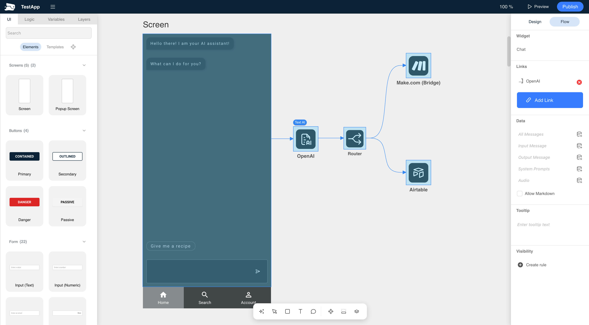

# Flowrabbit® Studio



## 🐰 What is Flowrabbit® Studio?

Flowrabbit® Studio is a modern Low-Code AI platform designed to build UI-centric GenAI workflows. At its core is an infinite canvas where you design beautiful user interfaces and complex workflows in one unified environment.

Think Figma meets n8n, but specifically built for AI applications and human-in-the-loop processes.

### ✨ Key Features

- **🎨 User Interface Design Visual Canvas** - Design beautiful user interfaces on an infinite canvas with drag-and-drop components. Text-to-Design AI generates UIs from prompts. (We are looking for contributors to improve our AI.)

- **🤖 Connect Any LLM or API** - Visually connect UI elements to OpenAI, Claude, Gemini, n8n, Make.com, and any REST API. See your entire data flow in one window conntected to the UI elements.

- **🔄 Human-in-the-Loop Workflows** - Build approval dashboards and interactive forms that connect to your existing automation workflows and AI agents.

- **🐳 Self-Host with Docker** - Deploy with Docker for complete control. Open-source (Apache 2.0), unlimited executions, no vendor lock-in.


You can try out Flowrabbit® Studio at [https://studio-os.flowrabbit.ai/#/](https://studio-os.flowrabbit.ai) Note: This is a demo version for experimentation only. No warranties or guarantees are made. It is just for presentation and checking the software out.

# Installation


Create a docker-compose.yaml and copy and adapt the content listed below. Once done, just type 

```sh
docker compose up
```

to start Flowrabbit. Make sure you have installed Docker before and have a domain name.

Flowrabbit® Studio supports two deployment modes:

- Single-domain (recommended for Elestio / one-click hosting): path-based routing on one domain
- Legacy subdomain mode: host-based routing (`api.*`, `studio.*`, `proxy.*`, `apps.*`, `docs.*`) via override file

Start by creating a `.env` file from `.env.example` and setting required secrets.

For single-domain mode, set `FLR_PUBLIC_URL` in `docker-compose.yaml`, for example:

> Note: The long compose snippet below is kept for reference and may lag behind current defaults. Use `docker-compose.yaml` in this repository as source of truth.

```yaml
FLR_PUBLIC_URL: https://flowrabbit.example.com
```

In single-domain mode this will expose:

- `https://flowrabbit.example.com/` -> studio
- `https://flowrabbit.example.com/api` -> backend
- `https://flowrabbit.example.com/proxy` -> proxy
- `https://flowrabbit.example.com/apps` -> apps
- `https://flowrabbit.example.com/docs` -> docs

The docker compose file also spins up Traefik for routing on port `80`.
TLS should be terminated by your hosting platform (for example, Elestio ingress/load balancer).

Use these commands:

```sh
# Single-domain mode (default)
docker compose up -d

# Local mode (forces public URL to localhost)
docker compose -f docker-compose.yaml -f docker-compose.local.yaml up -d

# Legacy host-based mode (optional compatibility mode)
docker compose -f docker-compose.yaml -f docker-compose.legacy-hosts.yaml up -d
```


Also, you need to set the `FLR_CLIENT_API_KEY`, `FLR_JWT_PASSWORD`, `FLR_DB_ENCRYPTION_KEY` and `FLR_ADMIN_PASSWORD` 
to ensure data is stored securely. 


```yaml
x-common-env: &common-env
  FLR_API_URL: https://api-os.flowrabbit.ai
  FLR_APPS_URL: https://apps-os.flowrabbit.ai
  FLR_PROXY_URL: https://proxy-os.flowrabbit.ai
  FLR_NODE_URL: https://node-os.flowrabbit.ai
  FLR_HTTP_HOST: https://studio-os.flowrabbit.ai
  TZ: America/Chicago
  FLR_AUTH_SERVICE: qux
  FLR_USER_ALLOW_SIGNUP: "true"
  FLR_USER_ALLOWED_DOMAINS: "*"
  FLR_CLIENT_API_KEY: Put_Some_Secret_In_Here
  FLR_ADMIN_EMAIL: email@example.com
  FLR_ADMIN_PASSWORD: Put_Some_Secret_In_Here
  FLR_INTERNAL_API_URL: http://backend:8080
  FLR_INTERNAL_PROXY_URL: http://proxy:8084

services:
  traefik:
    image: traefik:v3.0
    command:
      # Providers
      - "--providers.docker=true"
      - "--api.dashboard=true"

      # Entrypoints
      - "--entrypoints.web.address=:80"
      - "--entrypoints.websecure.address=:443"

      # Redirect all HTTP -> HTTPS
      - "--entrypoints.web.http.redirections.entrypoint.to=websecure"
      - "--entrypoints.web.http.redirections.entrypoint.scheme=https"

      # ACME / Let's Encrypt
      - "--certificatesresolvers.myresolver.acme.email=support@flowrabbit.ai"
      - "--certificatesresolvers.myresolver.acme.storage=/letsencrypt/acme.json"
      - "--certificatesresolvers.myresolver.acme.httpchallenge=true"
      - "--certificatesresolvers.myresolver.acme.httpchallenge.entrypoint=web"
      - "--certificatesresolvers.myresolver.acme.caserver=https://acme-v02.api.letsencrypt.org/directory"

      # Request certs at startup (not just on first request)
      - "--certificatesresolvers.myresolver.acme.tlschallenge=true"
      - "--entrypoints.websecure.http.tls.certresolver=myresolver"
      - "--entrypoints.websecure.http.tls.domains[0].main=docs-os.flowrabbit.ai"


    ports:
      - "80:80"
      - "443:443"
    volumes:
      - "/var/run/docker.sock:/var/run/docker.sock:ro"
      - "./letsencrypt:/letsencrypt"

  mongo:
    restart: always
    container_name: mongo
    image: mongo
    volumes:
      - ./mongo-data:/data/db        # pth for the data to be stored and kept on your host machine is on the left side of the ":"
  backend:
    restart: always
    container_name: backend
    image: flowrabbit/backend:latest
    volumes:
      - ./app-data:/app-data
    environment:
      <<: *common-env
      FLR_HTTP_PORT: 8080
      FLR_MONGO_DB_NAME: quantux
      FLR_MONGO_TABLE_PREFIX: quantux
      FLR_MONGO_CONNECTION_STRING: mongodb://mongo:27017
      FLR_MAIL_USER: 
      FLR_MAIL_PASSWORD: 
      FLR_MAIL_HOST: 
      FLR_DB_ENCRYPTION_KEY: some-long-string-of-mix-case-chars-and-nums
      FLR_JWT_PASSWORD: some-long-string-of-mix-case-chars-and-nums
      FLR_IMAGE_FOLDER_USER: /app-data/qux-images
      FLR_IMAGE_FOLDER_APPS: /app-data/qux-image-apps 
    depends_on:
      - mongo
    labels:
      - "traefik.enable=true"
      - "traefik.http.routers.api.rule=Host(`api-os.flowrabbit.ai`)" # update here
      - "traefik.http.routers.api.entrypoints=websecure"
      - "traefik.http.routers.api.tls.certresolver=myresolver"
      - "traefik.http.services.api.loadbalancer.server.port=8080"
  studio:
    restart: always
    container_name: studio
    image: flowrabbit/studio:latest
    environment:
        <<: *common-env
    labels:
      - "traefik.enable=true"
      - "traefik.http.routers.studio.rule=Host(`studio-os.flowrabbit.ai`)" # update here
      - "traefik.http.routers.studio.entrypoints=websecure"
      - "traefik.http.routers.studio.tls.certresolver=myresolver"
      - "traefik.http.services.studio.loadbalancer.server.port=8082"
  proxy:
    restart: always
    container_name: proxy
    image: flowrabbit/proxy:latest
    environment:
        <<: *common-env
    labels:
      - "traefik.enable=true"
      - "traefik.http.routers.proxy.rule=Host(`proxy-os.flowrabbit.ai`)" #update here
      - "traefik.http.routers.proxy.entrypoints=websecure"
      - "traefik.http.routers.proxy.tls.certresolver=myresolver"
      - "traefik.http.services.proxy.loadbalancer.server.port=8084"
  apps:
    restart: always
    container_name: apps
    image: flowrabbit/apps:latest
    environment:
        <<: *common-env
    labels:
      - "traefik.enable=true"
      - "traefik.http.routers.apps.rule=Host(`apps-os.flowrabbit.ai`)" #update here
      - "traefik.http.routers.apps.entrypoints=websecure"
      - "traefik.http.routers.apps.tls.certresolver=myresolver"
      - "traefik.http.services.apps.loadbalancer.server.port=8083"
  docs:
    restart: always
    container_name: docs
    image: flowrabbit/docs:latest
    environment:
        <<: *common-env
    labels:
      - "traefik.enable=true"
      - "traefik.http.routers.docs.rule=Host(`docs-os.flowrabbit.ai`)" #update here
      - "traefik.http.routers.docs.entrypoints=websecure"
      - "traefik.http.routers.docs.tls.certresolver=myresolver"
      - "traefik.http.services.docs.loadbalancer.server.port=8085"
```


# Dev Setup

## Main Modules

- studio: The Flowrabbit® studio (based on Quant-UX)
- backend: The Flowrabbit® backend (based on Quant-UX)

## Helper Modules

- proxy: Proxy server to access certain APIs and handle secrets
- docs: PDF and Audio processor
- apps: Responsive Viewer for flowrabbit apps (based on Luisa.could)
- websockey: Websockert server for realtime collaboration
